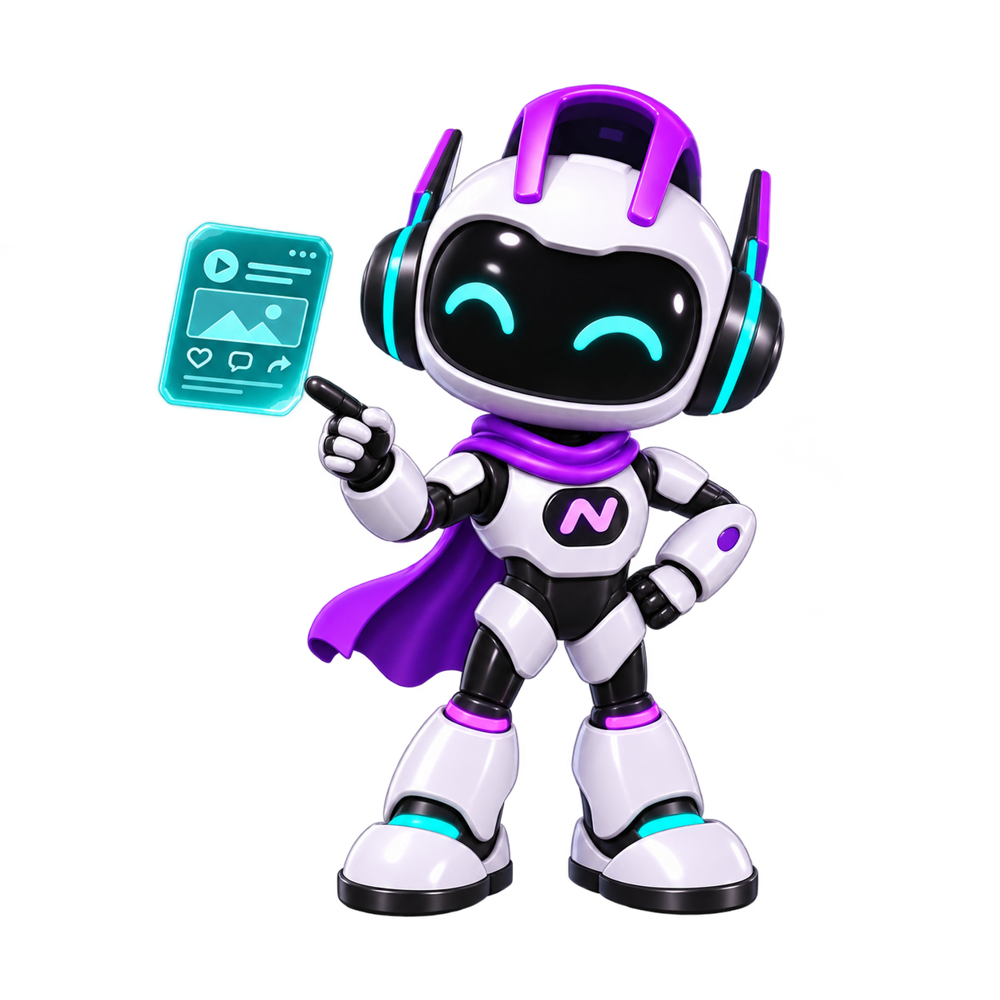

# 🚀 NovaSMM — Next-Gen Telegram SMM Panel & Service Experience

<div align="center">


### An immersive, ultra-responsive, and production-grade Telegram SMM storefront and interactive workspace.

[](https://smm.solmaz.ggff.net)
[](https://react.dev/)
[](https://www.typescriptlang.org/)
[](https://tailwindcss.com/)
[](https://vitest.dev/)
[](https://t.me/mrVXBoT)

</div>

---

## 📸 Visual Showcase & Previews

<div align="center">
  <table>
    <tr>
      <td width="50%" align="center">
        <strong>✨ Telegram Stars Studio</strong><br />
        
      </td>
      <td width="50%" align="center">
        <strong>💎 Telegram Premium Studio</strong><br />
        
      </td>
    </tr>
    <tr>
      <td width="50%" align="center">
        <strong>📈 Channel Growth Campaign Studio</strong><br />
        
      </td>
      <td width="50%" align="center">
        <strong>💳 Wallet, Ledger & Top-Up Gateway</strong><br />
        
      </td>
    </tr>
  </table>
</div>

---

## 🌟 What is NovaSMM?

**NovaSMM** is an advanced, high-performance web platform designed to redefine social media marketing (SMM) platforms. Unlike generic, outdated bootstrap-style SMM scripts, NovaSMM delivers an **Apple-grade, frictionless digital experience** tailored specifically for the Telegram ecosystem.

Every interaction—from selecting Stars bundles to calculating integer-cent order balances, handling real-time ticket threads, and navigating via keyboard shortcuts—is engineered for maximum responsiveness, fluid micro-animations, and visual delight.

---

## ✨ Core Features

### 1. 🛍️ Dedicated Product Order Studios
* **Telegram Stars:** Dynamic package selection (50 to 5,000+ Stars) with instant live preview and custom quantity calculation.
* **Telegram Premium:** 3-month and 12-month subscription gift flows with animated perk exploration (exclusive emoji, badges, speed boosts).
* **Channel Growth Campaigns:** Granular targeting for Post Views, Member/Subscriber boosts, and Reaction campaigns with exact handle validation.

### 2. 💰 Financial Engine & Dual-Entry Ledger
* **Precise Minor-Unit Arithmetic:** All balances, discounts, and charges are computed strictly in minor integer units (cents) to eliminate JavaScript floating-point rounding errors.
* **Live Wallet & Transaction Records:** Real-time ledger tracking deposits, charges, order adjustments, and refund histories.
* **Branded Demo Checkout:** Interactive simulated gateway with credit card field validation, simulated image-code verification, and instantaneous state transitions.

### 3. 🎨 Bespoke Mascot & Character System
* **Contextual Mascot Expressions:** Featuring **Nova**, a tailored 3D mascot that reacts in real-time to user focus, privacy states (hiding eyes when typing passwords), and celebratory success events.
* **Refined Aesthetics:** Seamless Dark and Light theme engine, glassmorphic floating header, reactive sidebar dock, and smooth Lenis kinetic scrolling.

### 4. ⚡ Power-User Tools & Accessibility
* **Command Palette (⌘K / Ctrl+K):** Lightning-fast service search, direct navigation, and keyboard-driven actions.
* **Support Ticket Desk:** Interactive ticketing system with state persistence, priority tagging, and multi-turn message threads.
* **Admin Control Center:** User directory oversight, order status transitions, transaction auditing, and ticket resolution management.

---

## 🛠️ Tech Stack & Architecture

| Layer | Technology | Purpose |
| :--- | :--- | :--- |
| **Framework** | **React 19** + **Vite 6** | Cutting-edge concurrent UI rendering and ultra-fast HMR |
| **Language** | **TypeScript 5.8 (Strict)** | End-to-end type safety with zero unchecked `any` |
| **Styling** | **Tailwind CSS v4** + CSS Tokens | Modern zero-runtime design tokens, glassmorphism |
| **State** | **Zustand** + Persist Middleware | Reactive global stores with automatic schema hydration |
| **Validation** | **Zod** + **React Hook Form** | Strict runtime schema validation and error feedback |
| **Storage** | **Dexie.js (IndexedDB)** + LocalStorage | Client-side persistent relational database simulation |
| **Testing** | **Vitest** + **Testing Library** | 133 comprehensive unit, component, and integration tests |
| **Networking** | **Cloudflare Tunnel (`cloudflared`)** | Secure, zero-port-forwarded edge deployment |

---

## 💼 Custom SMM Panels & Bespoke Development Services
### طراحی و پیاده‌سازی پنل‌های اختصاصی SMM متناسب با برند و نیاز شما

> **آیا به یک پنل خدمات شبکه‌های اجتماعی (SMM Panel) مدرن، قدرتمند و کاملاً اختصاصی نیاز دارید؟**
>
> اگر می‌خواهید یک سایت یا وب‌اپلیکیشن فروش خدمات تلگرام، اینستاگرام، یوتیوب و شبکه‌های اجتماعی داشته باشید که از نظر طراحی ظاهری، هویت بصری، کاراکتر و مسکات سه‌بعدی اختصاصی و تجربه کاربری چندین سطح بالاتر از تمام رقبای بازار باشد، امکان طراحی و پیاده‌سازی کامل آن وجود دارد:
>
> * 🎨 **طراحی هویت بصری و کاراکتر (Mascot) منحصربه‌فرد** متناسب با نام تجاری شما
> * ⚙️ **اتصال به انواع ارائه‌دهندگان سرویس (API Integration)** و دریافت اتوماتیک سفارشات
> * 💳 **اتصال به درگاه‌های پرداخت ریالی، ارزی و رمزارز** (کریپتو، پرفکت مانی، تتر، زرین‌پال و...)
> * 📱 **طراحی ریسپانسیو و PWA / مینی‌اپ تلگرام (Telegram Mini App)** جهت دسترسی سریع کاربران
> * 🛡️ **معماری ماژولار، کدنویسی استاندارد و سرعت لود فوق‌العاده**

### 📬 راه‌های ارتباطی جهت سفارش و مشاوره:
* **تلگرام:** [**@mrVXBoT**](https://t.me/mrVXBoT)
* **ایمیل:** [ye.vx.org@gmail.com](mailto:ye.vx.org@gmail.com)
* **گیت‌هاب:** [github.com/mrVXBoT](https://github.com/mrVXBoT)

---

## 🚀 Quick Start (Local Setup)

### 1. کلون کردن مخزن و نصب وابستگی‌ها
```bash
git clone https://github.com/mrVXBoT/smm-panel-demo.git
cd smm-panel-demo
npm install
```

### 2. اجرای سرور توسعه
```bash
npm run dev
```
سپس آدرس `http://localhost:5173` را در مرورگر باز کنید.

### 3. اجرای تست‌ها و بررسی کیفیت کد
```bash
npm run typecheck    # بررسی سلامت تایپ‌ها (TypeScript Compiler)
npm run lint         # اعتبارسنجی استایل کد با ESLint 9
npm run test         # اجرای تمام ۱۳۳ تست واحد با Vitest
npm run build        # ایجاد باندل بهینه‌سازی‌شده برای پروداکشن
```

---

## 🔑 Demo Credentials (مشخصات ورود آزمایشی)

پروژه به صورت پیش‌فرض شامل دو اکانت آماده برای تست و بررسی بخش‌های کاربری و مدیریتی است:

| نقش | نام کاربری | رمز عبور | موجودی اولیه |
| :--- | :--- | :--- | :--- |
| **مشتری (Customer)** | `user77007` | `password123` | **$87.00** |
| **مدیر سیستم (Admin)** | `admin` | `adminpassword` | **$2,500.00** |

---

## 📄 License
This project is open-source and available under the [MIT License](LICENSE).
Designed & Developed with precision by [Amir (@mrVXBoT)](https://t.me/mrVXBoT).
